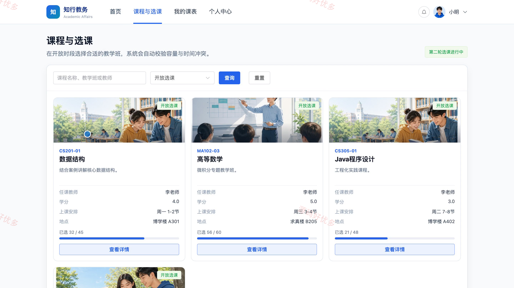
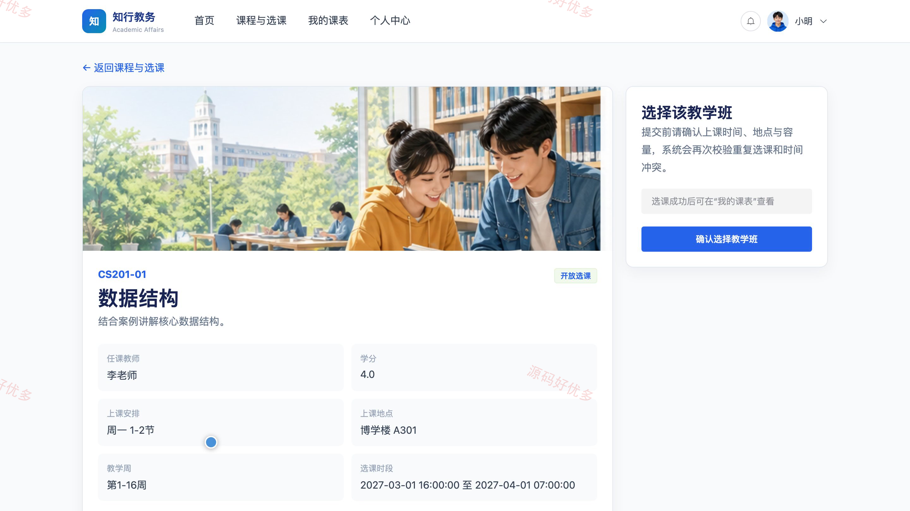
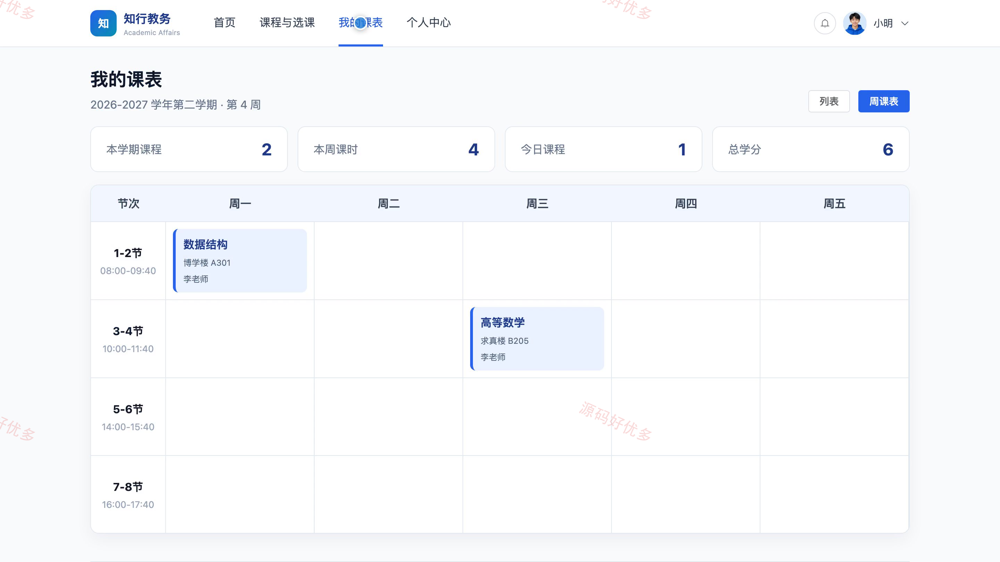
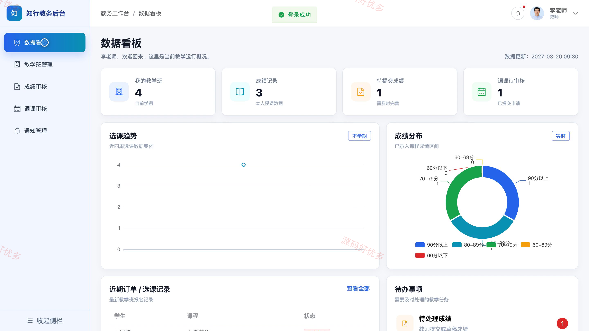
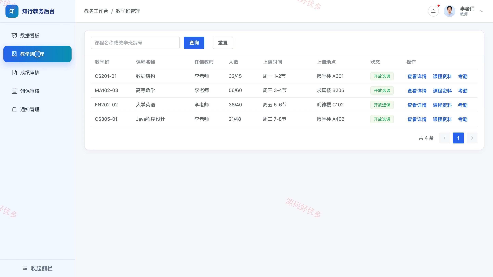
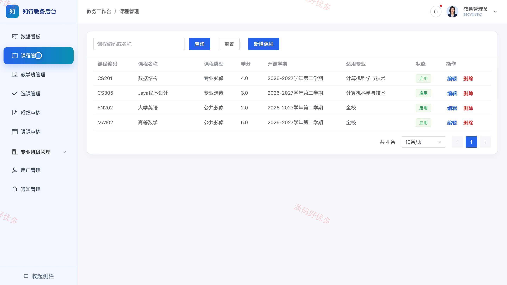
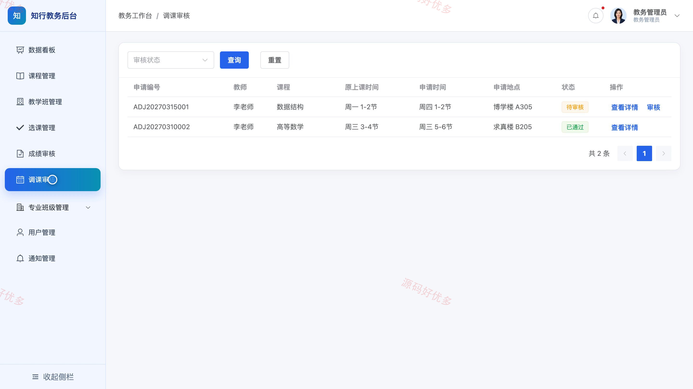

## 源码问题查看主页咨询

### 一、关键词
高校教务、学生选课、成绩查询、课程安排、教学事务

### 二、作品包含
源码+数据库+万字设计文档+PPT+全套环境和工具资源+本地部署教程

### 三、项目技术
前端技术： Html、Css、Js、Vue3.4、Element-Plus
后端技术：Python、Django

### 四、运行环境要求
开发工具：PyCharm + VSCODE

数据库：MySQL5.7+（共13张表）

数据库管理工具：Navicat10以上版本

环境配置软件： Python3+

前端Nodejs：16+

浏览器：谷歌浏览器

### 五、项目介绍
项目编号：bs044C

本系统面向学生、教师与教务管理员，覆盖课程安排、教学班、在线选课、成绩管理、调课申请及通知发布等业务，为日常教学事务提供统一的信息化管理入口。

角色：学生、教师、教务管理员

学生功能：浏览教学班与提交选课、查看个人课表、查询个人成绩、查看校内通知、维护个人资料、修改账号密码。

教师功能：查看教学数据、查看教学班与学生名单、维护课程资料、记录学生考勤、录入与提交成绩、提交调课申请、发布课程通知、维护个人资料。

教务管理员功能：管理专业与班级、管理课程与培养方案、管理教学班、管理选课记录、审核成绩、审核调课申请、管理师生账号、管理通知。

### 六、运行截图

